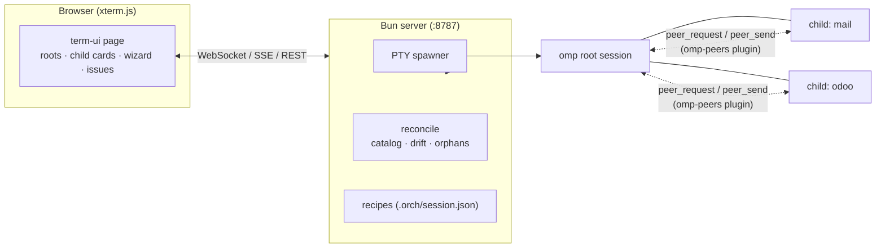

# io-ai — an orchestrator of live omp agent sessions

io-ai runs a **workspace of long-lived [omp](https://omp.sh) (Oh My Pi) coding-agent sessions** in your browser: one **root** orchestrator session, its **child** specialist sessions, each in its own terminal, each with its own model, thinking level, MCP servers and skills.

It does not read the screen and it does not guess. The server owns every agent process (PTY), every session's recipe, and reconciles the two: move a session folder with the Finder and the orchestrator follows, `/model` inside a session updates the recipe, a crashed child wakes its root.



## What you get

- **A session is a folder.** Anything under the workspace that contains `.orch/session.json` is a session; subfolders are its children (Next.js-style routing). The route is the path (`root-test/mail`), and the peer name follows (`root-test.mail`).
- **Recipes, not flags to remember.** Model, thinking, model roles, compaction, MCP servers, skills: stored per session, applied with `omp -r <id>` at every start. Conversations survive every restart.
- **Root/specialist split.** A root session gets the `ROOT-PROTOCOL` (it may spawn children only through `orch`, respecting quota) and root-only skills like `create-specialist-session`. Children answer with a strict 4-line REQ format.
- **Automations.** Schedules (5-field cron, local time) and webhook triggers (`POST /hook/<id>`) live in the recipe and wake an agent with `[orch schedule]` / `[orch trigger]`; delivery waits until the session is idle.
- **Role presets.** `presets/{coding,sales,support}`: a preset fills purpose, MCP servers, allowed built-in tools, environment (`inherit: minimal` + selected secrets), approval patterns and schedules, and replaces the AGENTS.md template.
- **Deliverables.** Files an agent writes to `./outbox/` (and the newest files of its folder) are listed and opened from the UI.
- **Deterministic drift handling.** `reconcile` runs every few seconds and converges: in-session `/model` and `/thinking` are adopted (with revert), global omp config changes flag `restart-needed`, never auto-restart, hand-moved folders are followed via omp's own `SessionManager.moveTo`, copies lose the session id, deleted folders become orphans you can forget or relink.
- **Health without screen-scraping.** An omp extension reports hello/state/heartbeat; the server sees process exits. Crashes reach the root as `[orch]` notices with a bounded auto-restart policy; stuck sessions are detected by heartbeat.
- **Operate-grade UI.** Live terminals with per-session model selector, working elapsed timers, issue cards with one-click actions, a two-step new-root wizard (mission, model, MCP servers, skills), graceful or forced stop of a whole subtree, archive instead of delete.
- **Cross-platform by design.** Relative paths everywhere, no git dependency, process-tree termination per OS. Terminals are POSIX today; Windows needs a ConPTY backend behind the existing `Pty` interface.

## Prerequisites

| Requirement | Notes |
|---|---|
| **omp** 18.12+ | `brew install can1357/tap/omp` (or npm). Log in to at least one provider (`omp` on first run). |
| **Bun** 1.3.5+ | Runs the server. The omp SDK helper needs 1.4.3+, pulled automatically as a local dependency. |
| **[omp-peers](https://github.com/nikkoxgonzales/omp-peers)** | Cross-session messaging: roots talk to children by peer name. |

Install the peers plugin (then restart any running omp):

```sh
omp plugin marketplace add nikkoxgonzales/omp-peers
omp plugin install omp-peers@omp-peers
```

Verify with `/peers` inside any omp session.

Optional: MCP servers you already have in `~/.omp/agent/mcp.json` (ms365, chrome-devtools, …) are picked up automatically by the catalog and offered per session.

## Quickstart

```sh
git clone https://github.com/singleflo/io-ai.git && cd io-ai
cd term-ui && bun install && cd ..
bun term-ui/service.ts install  # user service on :8787, default workspace ~/orch (foreground alternative: bun term-ui/server.ts)
bun term-ui/orch.ts url         # prints http://127.0.0.1:8787/login?t=<token>: open it once; the page then keeps a cookie
```

1. **New root** (sidebar) — a two-step wizard: name, mission, model, thinking; then MCP servers and skills (everything on by default; unchecking excludes a skill from that session only).
2. Talk to your root in its terminal. Ask it to create a specialist — it uses the `create-specialist-session` skill, scaffolds the child folder, starts it and sends `REQ-001 · bootstrap`.
3. Children appear as cards on the right: open one, watch its state and working timer, restart it with another model, or stop the whole subtree gracefully.

Environment: `ORCH_HOME` (workspace root, default `~/orch`), `PORT` (default 8787), `--workspace <path>`.

Access: the server creates `<workspace>/.orch/token` (mode 0600) and answers `401` to every request without it, except `GET /login` and `POST /hook/<id>`. `orch`, the sessions and `service.ts status` read it automatically. Work state (inbox, REQ register, usage, audit log) lives in `<workspace>/.orch/orch.db`.

Run the server as a user service so it survives closing the terminal (launchd on macOS, systemd `--user` on Linux; PATH, `ORCH_HOME` and `PORT` of the installing shell are baked in):

```sh
bun term-ui/service.ts install      # also: uninstall | status
```

## Workspace layout

```
~/orch/                        the workspace (no git needed)
  .orch/
    catalog.json               snapshot of omp: models, quota, MCP, skills
    known.json                 session ids seen (orphans list)
    skills/{common,root}/      your own skills, injected per role
    templates/{root,child}/    AGENTS.md templates (optional overrides)
    secrets.json               secret values by name (mode 0600, never returned by the API)
    presets/<role>/            role presets overriding the repo's presets/ (preset.json + AGENTS.md)
  root-test/                   a root session   → route "root-test"
    .orch/session.json         the recipe (id, model, mcp, skills, desired; `folder` = attached project folder)
    AGENTS.md                  domain rules; inherited by children
    mail/                      a child session  → route "root-test/mail"
  _archive/                    archived subtrees (nothing is ever deleted)
```

`AGENTS.md` files are inherited walking up (like layouts); the root *role* stays in `protocols/ROOT-PROTOCOL.md`, injected with `--append-system-prompt`, so children never see the orchestrator rules.

## The `orch` CLI

Roots (and you) manage sessions only through it:

```sh
bun term-ui/orch.ts list                                   # route · kind · state · peer · issues
bun term-ui/orch.ts spawn --name mail --parent ops --purpose "Mail triage" \
  --model zai/glm-5.3 --mcp ms365 --compact 55 --start
bun term-ui/orch.ts start|stop|restart <route> [--model M --thinking L …]
bun term-ui/orch.ts edit <route> --purpose "…" [--restart]
bun term-ui/orch.ts move <route> --to ops/mail2
bun term-ui/orch.ts archive <route> [--force]             # stop + move under _archive
bun term-ui/orch.ts send <route> "text"
bun term-ui/orch.ts resolve <route> <issue> <action>
bun term-ui/orch.ts models [filter] · usage · catalog [--refresh]
bun term-ui/orch.ts folder /abs/path                       # project skills, project MCP, omp conversations (live or not)
bun term-ui/orch.ts spawn --name api --parent ops --purpose "…" --folder /abs/repo --session latest --skills a,b --start
bun term-ui/orch.ts edit <route> --name new-name --mcp ms365 --skills all   # rename, then edit; takes effect after a restart
bun term-ui/orch.ts archive-list · restore <archive id>
bun term-ui/orch.ts spawn --name sales --parent ops --preset sales   # role preset: purpose, MCP, tools, env, approvals, schedules
bun term-ui/orch.ts edit <route> --tools read,grep,write            # allowed built-in tools (all = no limit); restart applies it
bun term-ui/orch.ts schedule add <route> "0 8 * * 1-5" "Morning review"   # cron, local time; list · rm <id>
bun term-ui/orch.ts trigger add <route> new-lead "New lead: {{body}}"       # prints http://127.0.0.1:<port>/hook/<id>
echo "$VALUE" | bun term-ui/orch.ts secret set DEMO_TOKEN                   # stored in .orch/secrets.json; select it per session (edit → Environment)
bun term-ui/orch.ts relocate <route> /abs/new-folder [--new-conversation]   # or --workspace to move a linked session into the workspace
```

Inside a root session the path is already known (`ORCH_ROUTE`), so `--parent` defaults to the root itself.

## Drift policy (what reconcile does)

| Change made outside | Behaviour |
|---|---|
| `/model`, `/thinking` in a session | adopted into the recipe, revert offered |
| omp retry fallback | ignored, shown as `in-fallback` |
| global config / `mcp.json` edit | MCP profiles regenerated, `restart-needed` flagged (never auto-restart) |
| `.omp/mcp.json` of a project | orch merges: it adds only disabled entries for user-level servers that no session on that folder selects (the union of the sharers) and removes only its own (`mcpOwned` in the recipes); a project's own definitions are never touched. Invalid JSON → `mcp-profile-invalid` |
| attached folder (linked session) | orch writes nothing there except those disabled MCP entries (`.omp/mcp.json` is appended to `.git/info/exclude` when orch created it); the recipe, `AGENTS.md`, outbox and prompt live in the session's workspace folder (`recipe.folder` is the working folder) |
| several sessions on one folder | allowed: `sharedWith` in `orch list`, a "shared folder" label on the cards, and a `shared-folder-busy` issue plus a root notice when two of them work at once |
| folder moved/renamed by hand | followed: omp file relocated with `moveTo`, same session id |
| `/move` inside a session | the session folder follows the conversation |
| folder copied | the copy loses the id and starts a new conversation |
| folder deleted | orphan listed: forget, or relink to a folder |
| linked folder moved/deleted | `link-broken` card: relink to the new folder, or archive; `relocate` changes a session's folder (same conversation, or a new one) |
| session opened elsewhere (`omp -r` in a terminal) | start refused (`open-elsewhere`), auto-starts when freed |
| omp upgraded | catalog rebuilt; SDK version checked and flagged |

## Development

```sh
cd term-ui
bun install
bun test            # (tests welcome — none yet)
bun run ..          # see package.json scripts
```

Layout: `server.ts` (HTTP/WS/SSE + creation) · `core.ts` (start pipeline, observer, issues) · `reconcile.ts` (convergence loop) · `catalog.ts` (omp snapshot) · `workspace.ts` (folder model) · `folder.ts` (folder picker and folder-info) · `service.ts` (launchd/systemd installer) · `pty.ts` (terminals, tree termination) · `omp-sdk.ts` (lease/`moveTo` helper process) · `orch-ext.ts` (extension loaded into every session). UI strings live in `term-ui/public/i18n/*.json`; code, commits and docs are English-only (see `AGENTS.md`).

Verified behaviours live in the session history of this repo's development: resume-by-id with recipe flags, hand-move while running, lease refusal, duplicate ids, global MCP changes, in-session `/move`, subtree graceful stop.

## Credits

- [omp / Oh My Pi](https://github.com/can1357/oh-my-pi) — the agent, its SDK and `SessionManager.moveTo` do the heavy lifting.
- [omp-peers](https://github.com/nikkoxgonzales/omp-peers) — named peer messaging between sessions.
